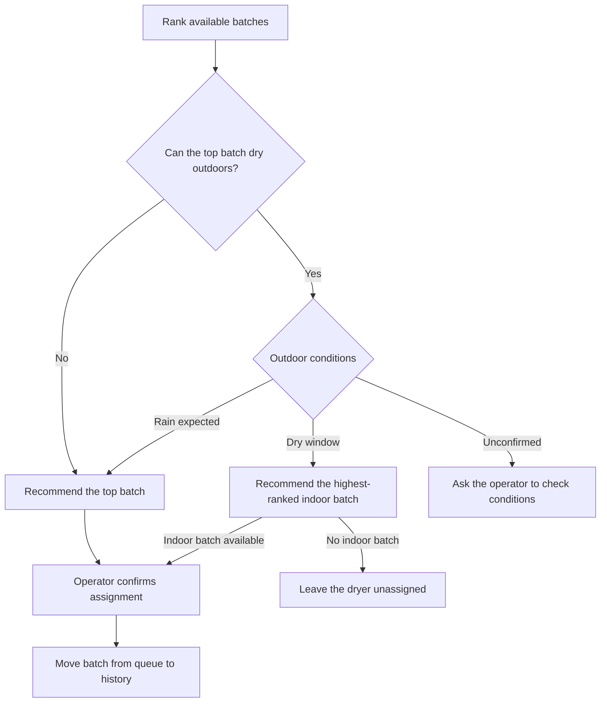
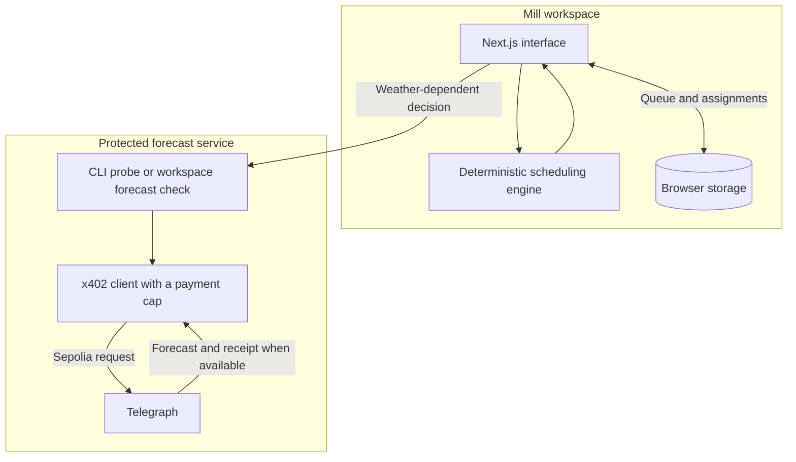

<div align="center">
  
  <h1>PaddyTurn</h1>
  <p><strong>Know what to dry next.</strong></p>
  <p><a href="https://paddyturn.vercel.app/">Product homepage</a> · <a href="https://paddyturn.vercel.app/app">Mill workspace</a></p>

  [](https://paddyturn.vercel.app/app)
  [](package.json)
  [](tsconfig.json)
  [](SECURITY.md)
</div>

## Mill workspace

PaddyTurn helps small rice mills and cooperative drying stations assign one mechanical dryer slot when several paddy batches arrive together.

1. **Add batches.** Enter arrival time, measured moisture, and outdoor drying eligibility.
2. **Set the priority.** Choose **Wettest first** or **First to arrive**.
3. **Record outdoor conditions.** Enter them manually or check Telegraph when weather could change the next assignment.
4. **Assign the next batch.** Check the recommendation, then record the assignment in history.

The queue, preferences, and history are stored in the current browser. Other devices have their own workspaces. Use physical moisture measurements and mill procedures for storage decisions.

## How the next turn is chosen



## Architecture



A usable forecast informs the current recommendation. The operator confirms the assignment. Unavailable or expired data calls for operator review. [Scheduling rules](lib/schedule.ts) · [Forecast client](lib/telegraph.ts)

## Local development

Use Node.js 24 and npm.

```sh
npm ci
npm test
npm run dev
```

Open [localhost:3000](http://127.0.0.1:3000/app). Run `npm run build` to verify the production build.

For provider discovery, run `npm run probe`. For a paid testnet forecast, copy [the environment template](.env.example) to `.env.local`, configure a dedicated Sepolia wallet funded with test USDC, then run `npm run probe -- --buy`. The probe reports the receipt when available. [Telegraph x402 documentation](https://anjoman.ai/docs/using/x402-inference)

For the workspace forecast, also configure `LOCAL_FORECAST_TOKEN` and enter it in **Optional forecast check**. Only an authorized operator can request a purchase. Forecast evidence is session-only.

## Verification

- **Workspace:** Browser walkthrough verified adding batches, switching weather choices, recording a dryer assignment, and recovering it from History after reload. The walkthrough used test batches.
- **Forecast:** Telegraph returned an x402 payment quote for the Pathein request. A funded Sepolia purchase, usable forecast response, and receipt have yet to be verified end to end.
- **Field use:** A mill-operator walkthrough and independent reproduction are still pending.

## Project policies

[Contributing](CONTRIBUTING.md) · [Security](SECURITY.md) · [Code of conduct](CODE_OF_CONDUCT.md)
