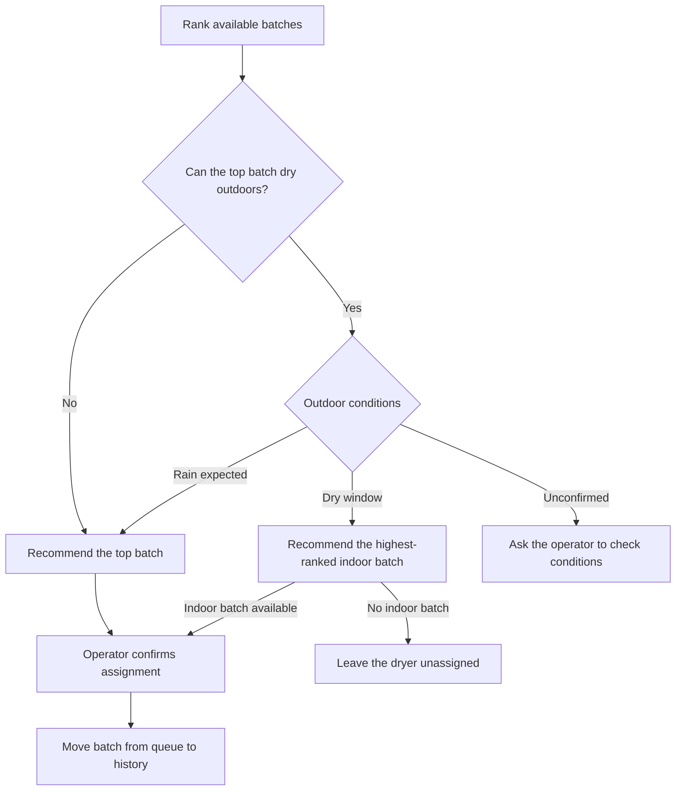
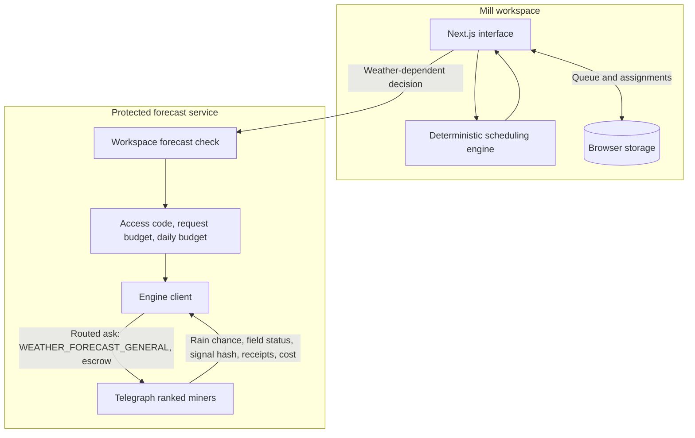

<div align="center">
  
  <h1>PaddyTurn</h1>
  <p><strong>Know what to dry next.</strong></p>
  <p><a href="https://paddyturn.vercel.app/">Product homepage</a> · <a href="https://paddyturn.vercel.app/app">Mill workspace</a></p>

  [](https://paddyturn.vercel.app/app)
  [](package.json)
  [](tsconfig.json)
  [](SECURITY.md)
</div>

## Mill workspace

PaddyTurn helps small rice mills and cooperative drying stations assign one mechanical dryer slot when several paddy batches arrive together.

1. **Add batches.** Enter arrival time, measured moisture, and outdoor drying eligibility.
2. **Set the priority.** Choose **Wettest first** or **First to arrive**.
3. **Record outdoor conditions.** Enter them manually or buy a rain-chance forecast through Telegraph when weather could change the next assignment.
4. **Assign the next batch.** Check the recommendation, then record the assignment in history.

The queue, preferences, and history are stored in the current browser. Other devices have their own workspaces. Use physical moisture measurements and mill procedures for storage decisions.

## How the next turn is chosen



## Architecture



A forecast informs the recommendation only when Telegraph verified the rain-chance field and returned a signal hash or payment receipt within budget. The operator confirms the assignment. Unavailable, partial or expired data calls for operator review. [Scheduling rules](lib/schedule.ts) · [Engine client](lib/engine.ts) · [Forecast rules](lib/forecast.ts)

## Why buy the forecast through Telegraph

A free weather app tells the operator what might happen. PaddyTurn keeps **why a batch was dried when it was**: which ranked provider answered, the rain chance it returned, what the check cost, and a signal hash and receipt that anyone can look up later. Cooperatives, mill owners and crop-loss or insurance reviews can audit a disputed drying decision instead of relying on memory. A check costs about one cent of test USDC on testnet, and only happens when an outdoor-eligible batch is at the top of the queue.

## Telegraph Hackathon

PaddyTurn is prepared for **Telegraph Season II — Apps & Agents, Mission 06: Resources & Agriculture**. The workspace makes a routed, budgeted ask for the live `WEATHER_FORECAST_GENERAL` testnet intent, so Telegraph picks the best-ranked miner and can fall back to another one. The decision uses the intent's `precipitation_probability_pct` field only when its `field_status` is `ok`. The evidence record keeps the location, rain chance, limit, provider, cost, signal hash and `fulfillment.payments` receipts with the dryer assignment.

See [HACKATHON.md](HACKATHON.md) for the reviewer flow, evidence checklist, demo script, and public-update drafts. This project labels testnet evidence, unverified field use, and any limitations honestly.

## Local development

Use Node.js 24 and npm.

```sh
npm ci
npm test
npm run dev
```

Open [localhost:3000](http://127.0.0.1:3000/app). Run `npm run build` to verify the production build.

For provider discovery, run `npm run probe`. Run `npm run probe -- --quote` to verify the Pathein request and inspect the Sepolia quote without signing or paying. The amount is in millionths of test USDC. For a paid testnet forecast, copy [the environment template](.env.example) to `.env.local`, configure a dedicated Sepolia wallet funded with test USDC, then run `npm run probe -- --buy`. The probe reports the receipt when available. [Telegraph x402 documentation](https://anjoman.ai/docs/using/x402-inference)

For the workspace forecast, configure server-side `TELEGRAPH_API_KEY`, `LOCAL_FORECAST_TOKEN`, `TELEGRAPH_MAX_SPEND_USD=0.10` and `TELEGRAPH_DAILY_BUDGET_USD=1`. Check your Anjoman account has available testnet escrow, and keep that balance small. Open **Optional forecast check** and enter the workspace access code. The server sends only the place name and window, reserves the request budget against the daily budget, and settles to the observed cost. History saves the receipts, signal hash and cost when the forecast informs an assignment. [Anjoman API setup](https://anjoman.ai/docs/using/api-keys) · [Engine reference](https://anjoman.ai/docs/using/engine-ask)

To check any recorded signal: `curl https://devnode.telegraphprotocol.com/engine/v1/signal/<signal_hash>`.

## Verification

- **Workspace:** Browser walkthrough verified adding batches, switching weather choices, recording a dryer assignment, and recovering it from History after reload. The walkthrough used test batches.
- **Forecast (testnet, verified 22 Nov 2026):** the production workspace bought a `WEATHER_FORECAST_GENERAL` forecast for Pathein, Myanmar from Anjoman testnet escrow. Telegraph routed it to Isobar Weather (miner 279), charged 10000 μUSDC (0.01 test USDC, epoch 38), and returned receipt `0x2ccd9c310cb690c857d5e4ddeff712aeb72e741feb2d3857ab3f13c6124dfed3` and signal `0xe3a3b8cb58386e5854bfd8d50ba4aeb5a218f4379c546d95751689fa2d128c7f`. The verified rain chance (0%, clear) was below the 40% limit, so PaddyTurn recommended outdoor drying. Check the signal: `curl https://devnode.telegraphprotocol.com/engine/v1/signal/0xe3a3b8cb58386e5854bfd8d50ba4aeb5a218f4379c546d95751689fa2d128c7f`.
- **Window:** the provider's shaped answer is a daily peak; PaddyTurn now reads the hourly data from Telegraph's public record and decides on the exact window, falling back to the daily peak only when the record is not yet published.
- **Field use:** A mill-operator walkthrough and independent reproduction are still pending.

## Reviewer walkthrough

1. Open the workspace and add two test batches. Give the first a higher moisture reading and allow it to dry outdoors. Keep the second indoors.
2. Use **Wettest first** and **Not sure**. The workspace should ask for weather. Open **Optional forecast check**, enter the access code privately, and run a forecast for the mill location (try your own town too).
3. Check the rain chance, limit, provider, receipt, signal hash and cost. Run it again with the limit set above and then below the returned chance to see the recommendation flip (each run is a separate paid check). Confirm the recommended batch, reload, open **History**, and expand **View evidence**.
4. For a failure case, use a deliberately invalid access code on a weather-dependent queue. The app should ask for operator review and show no paid job evidence.
5. Look up the signal hash with the `curl` command above. Label the queue as test data unless supplied by an operator. The quote alone does not prove settlement.

## Mill workspaces (optional)

Connect **Upstash for Redis** to the Vercel project (Storage tab) to turn on:

- **Sync with a mill code** under the queue: the same queue and history on every device that knows the code. Only a hash of the code is stored, and workspace data is validated and size-capped.
- **Active days:** each day a mill saves changes is recorded, so repeat use is visible ("active on N days").
- **Shared daily budget:** one atomic counter per UTC day across all server instances.

Without Redis, everything stays in the browser and the daily budget is per server instance.

## Proof pages and cross-check

Every forecast has a public page at `/proof/<signal_hash>`, rendered from Telegraph's public signal record. After each paid answer the server reads that record (free), requires `verified: true` and a matching intent, and decides on the provider's hourly rain chance for the exact requested window. If the record is not yet published, the provider's daily peak is used and labelled.

## What changes for mainnet

- Set `TELEGRAPH_API_BASE` to the production Anjoman endpoint and use a production API key with a funded escrow. No code changes.
- Keep the per-request and daily budgets, and move the daily budget to a shared store (for example Redis) so it holds across serverless instances.
- Replace the shared access code with per-mill accounts, and move the queue from browser storage to a server database so a cooperative can see several mills.
- Keep the evidence rules: no verified field status, signal hash or receipt, no forecast-based decision.

## Project policies

[Contributing](CONTRIBUTING.md) · [Security](SECURITY.md) · [Code of conduct](CODE_OF_CONDUCT.md)
